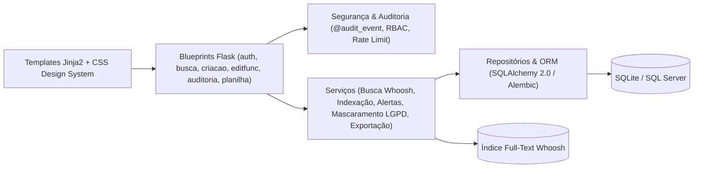

# Nexus Ops — Plataforma Corporativa de Gestão de Pessoas, Contratos & Conformidade

[](https://www.python.org/)
[](https://flask.palletsprojects.com/)
[](https://www.sqlalchemy.org/)
[](https://whoosh.readthedocs.io/)

Plataforma web corporativa desenvolvida para unificar o **Painel Executivo de Gestão**, busca instantânea *full-text* de colaboradores efetivos e terceirizados, governança de contratos com fornecedores, trilha de auditoria compatível com a **LGPD** e observabilidade operacional em produção.

---

## Visão Geral & Destaques de Engenharia

- **Meu Painel de Gestão (`/painel`)**: Dashboard executivo com KPIs em tempo real (headcount ativo, razão Efetivos vs. Terceirizados, contratos vigentes, integrações recentes nos últimos 90 dias), distribuição proporcional por diretoria, ranking de departamentos e fornecedores, além de diretório interativo com filtragem instantânea por vínculo e diretoria.
- **Busca Corporativa Full-Text (`Whoosh`)**: Indexação dedicada com remoção automática de acentos, busca exata/parcial por CPF, RG, matrícula, cargo, departamento, diretoria ou empresa contratada, e seletor dinâmico de colunas em sessão.
- **RBAC Granular por Escopo Organizacional**:
  - `DIRETORIA` / `RH`: acesso corporativo global a colaboradores `EFETIVO` e `TERCEIRIZADO`.
  - `TECH` / `OPERACOES` / `FINANCEIRO`: acesso escopado exclusivamente a prestadores `TERCEIRIZADO` alocados na respectiva diretoria (`DIR.TECH`, `DIR.OPS`, `DIR.FIN`).
- **Auditoria Imutável & Higiene LGPD (`routes/auditoria.py` + `services/auditoria_services.py`)**:
  - Cobertura de `@audit_event` validada via análise AST (`scripts/check_audit_coverage.py`) em 100% das rotas de negócio.
  - Mascaramento automático de CPF, e-mail, telefone e chaves sensíveis antes da persistência dos detalhes em JSON.
  - Registro estruturado de diff (`antes` vs. `depois`) em alterações cadastrais e de permissões.
  - Política de retenção e expurgo configurável por categoria (`scripts/purge_audit_logs.py`).
- **Segurança Defensiva (`services/alertas_seguranca.py`)**:
  - Proteção CSRF (`Flask-WTF`), Rate Limiting (`Flask-Limiter` + página `429`), cabeçalhos CSP/HSTS/X-Frame-Options.
  - Detecção de *brute force* com bloqueio temporário por IP, cooldown configurável, alerta de uso de Superadmin fora de horário e alerta de exportação massiva via SMTP ou Webhook.
- **Observabilidade & Exportação**:
  - Endpoints `/healthz`, `/readyz` e `/metrics` (formato Prometheus) + painel visual `/observabilidade`.
  - Exportação formatada em Excel (`.xlsx` via `XlsxWriter`) e trilhas de auditoria em `.csv`.

---

## Arquitetura em Camadas



---

## Execução Rápida (Ambiente de Demonstração)

1. **Crie e ative o ambiente virtual, depois instale as dependências:**
   ```bash
   python -m venv .venv
   # Windows (PowerShell):
   .venv\Scripts\Activate.ps1
   # Linux/macOS:
   source .venv/bin/activate

   pip install -r requirements.txt
   ```

2. **Configure o arquivo `.env` (opcional em desenvolvimento — há fallbacks seguros para SQLite local):**
   ```bash
   cp .env.example .env
   ```

3. **Popule o banco local com dados fictícios de portfólio e reconstrua o índice Whoosh:**
   ```bash
   python scripts/seed_demo.py --reset
   ```

4. **Inicie a aplicação:**
   ```bash
   python app.py
   ```
   Acesse `http://localhost:8080/login`.

---

## Credenciais de Demonstração (`seed_demo.py`)

| Usuário | Senha | Perfil RBAC | Nível de Acesso |
| :--- | :--- | :--- | :--- |
| `admin` | `Admin@2026!` | `DIRETORIA` | Superadmin (Painel Global, Auditoria, Usuários, Observabilidade) |
| `gestao.rh` | `Nexus@2026!` | `RH` | Superadmin (Gestão Corporativa Global) |
| `lider.tech` | `Nexus@2026!` | `TECH` | Admin Escopado (Terceirizados de `DIR.TECH`) |
| `gestao.ops` | `Nexus@2026!` | `OPERACOES` | Admin Escopado (Terceirizados de `DIR.OPS`) |

---

## Testes Automatizados & Verificações

```bash
# Suíte completa de testes unitários e de integração
python -m unittest discover -s tests -p "test_*.py" -v

# Auditoria estática AST de cobertura de @audit_event nas rotas
python scripts/check_audit_coverage.py
```

---

## Autoria

Projeto desenvolvido e arquitetado por **Vittor Oliveira (`@Vyxoox`)** para demonstração de portfólio em engenharia de software backend, segurança aplicada e governança de dados.
